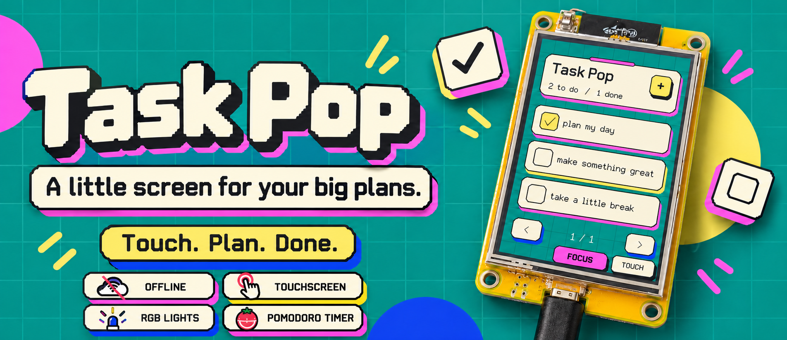
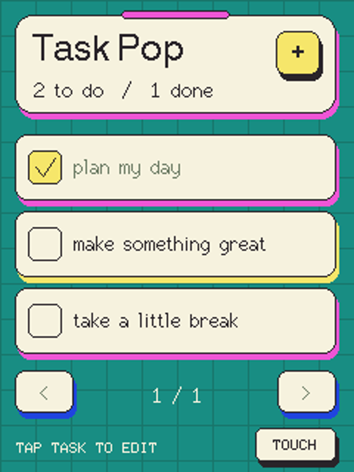
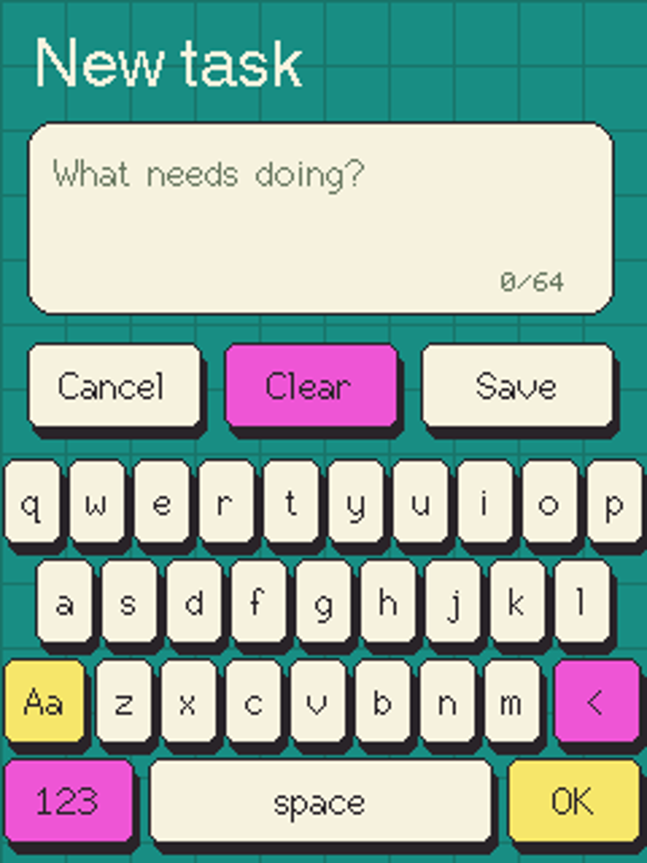
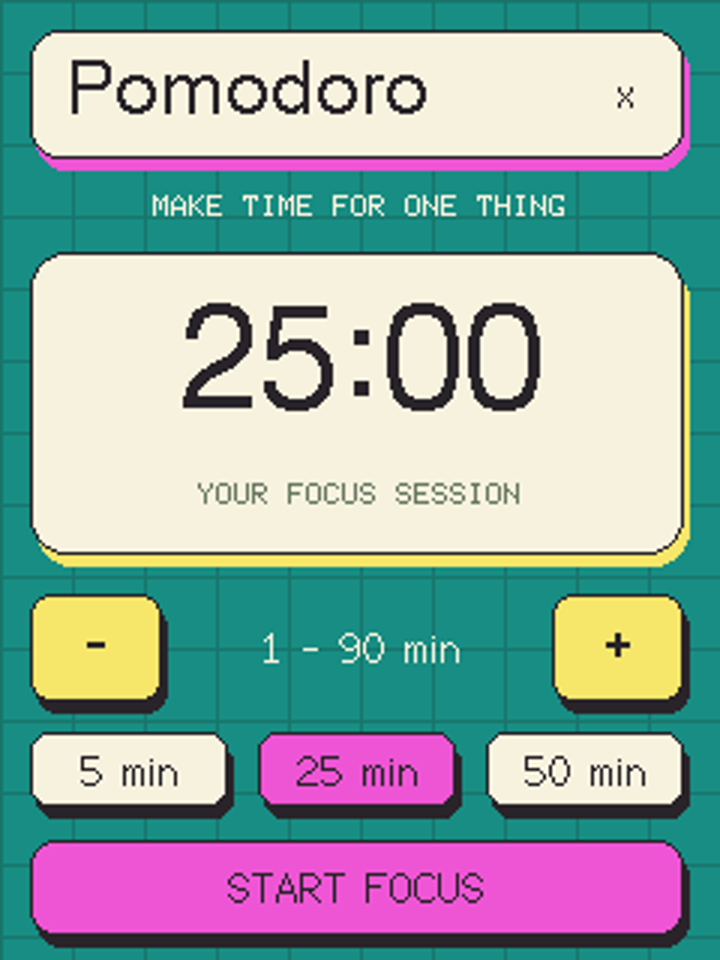
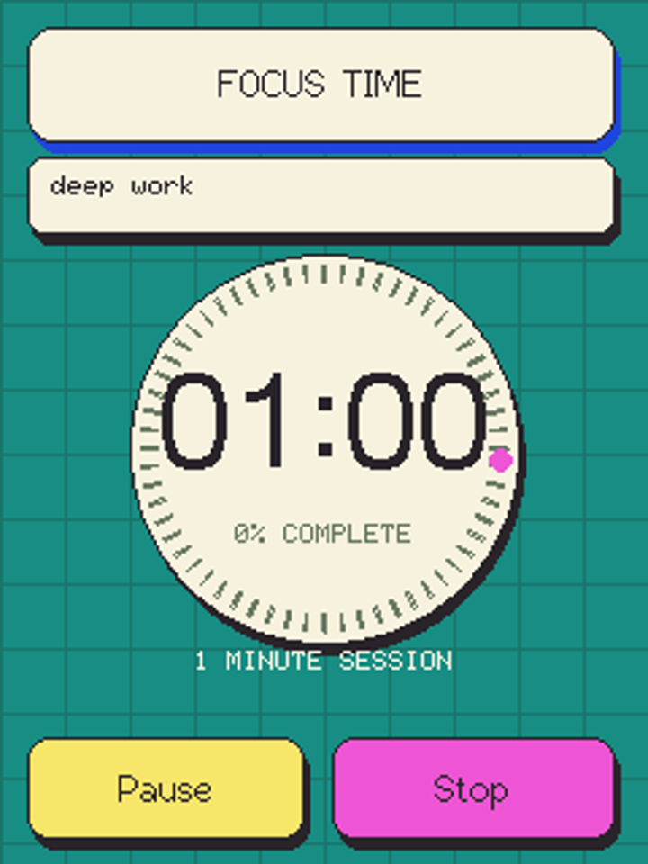
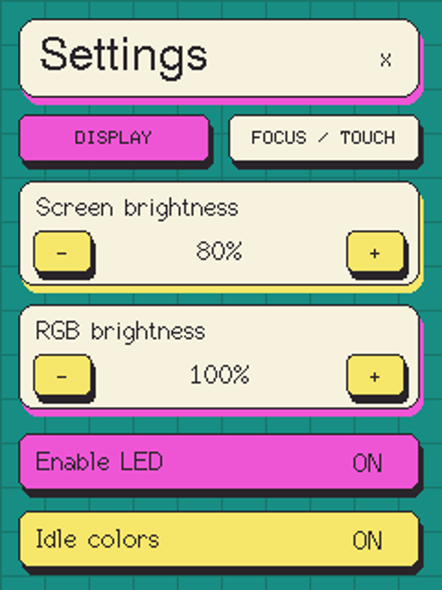
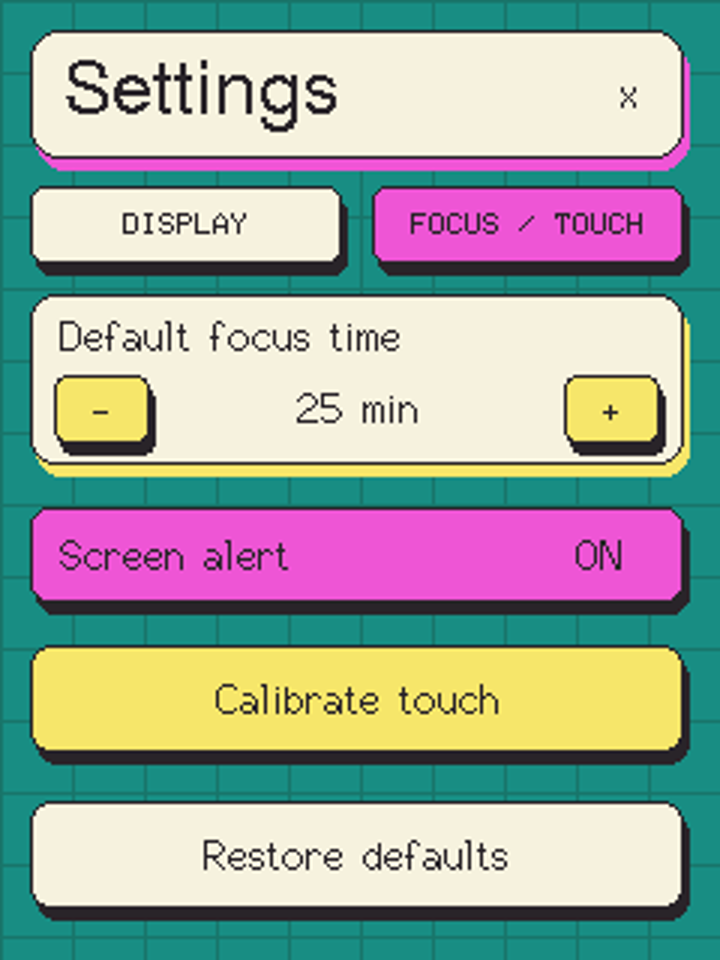

# Task Pop

### A little screen for your big plans.

A colorful, touch-first to-do companion for your desk.  
Powered by a CYD-style ESP32 display. Built to work offline.

**Touch to plan · Light to celebrate · Unplug without forgetting**

&nbsp;&nbsp;

*Your task list and on-screen keyboard — captured from the running interface.*

## Make room for what matters

Task Pop turns a small ESP32 touchscreen into a dedicated home for your daily tasks. Add a plan, check it off, and let a little burst of color mark the moment. No phone, account, or Wi-Fi required.

- **Plan by touch.** Add and edit tasks with the on-screen English keyboard.
- **Stay in control.** Mark tasks done, delete them, or undo an accidental deletion.
- **Pick up where you left off.** Tasks stay saved when power is disconnected.
- **Feel the progress.** The onboard RGB LED responds with a different light gesture for each action.
- **Focus on a task.** Pick what to work on, run a Pomodoro session, and keep its focus time and completed-session count with that task.
- **Make it yours.** Adjust screen brightness, RGB lighting, alerts, and your default focus duration in Settings.
- **Keep it simple.** Up to 30 tasks, three per page, with a bright teal, cream, pink, and yellow interface.

## A little personality, built in

| What you do | How Task Pop responds |
| --- | --- |
| Add a task | Two playful yellow pulses |
| Complete it | A green glow that fades away |
| Delete it | Three diminishing red flashes |
| Save an edit | A pink flourish |
| Undo a deletion | A cyan pulse |
| Take a moment | A gentle 30-second journey through the interface colors |

Light animations run alongside the interface, so you can keep using the touchscreen.

## Make time for one thing

Tap the pink **FOCUS** button, choose a task, and open its Pomodoro timer. Pick **5, 25, or 50 minutes**, or adjust the duration from **1 to 90 minutes**. The task name stays visible throughout the session.

&nbsp;

Follow the moving progress ring as the timer counts down. **Pause** keeps your remaining time; **Stop** takes you straight back to your tasks. At the end, the screen pulses yellow and the RGB LED flashes green until you tap **BACK TO TASKS**. Each task keeps its accumulated focus time and completed sessions, even after renaming or restoring it with Undo.

## Set the mood

Open **SETTINGS** beside **FOCUS** to adjust screen and RGB brightness, switch RGB lighting or idle colors off, set your default focus duration, control the flashing completion alert, or calibrate the touchscreen. **Enable LED** is the master light switch. When it is off, **Idle colors** is dimmed and unavailable; switching it back on restores your idle-color preference. Changes are saved automatically. Restore defaults resets these preferences while keeping your tasks and touch calibration.

&nbsp;

## Made for a small screen

**2.8-inch touch display · ESP32 · Onboard RGB LED · USB power**

This version runs on the **LCDWIKI E32R28T / ESP32-32E**, a CYD-style board with an ILI9341V display and XPT2046 resistive touch. The screen is upright with the **USB connector at the bottom**.

CYD boards come in different variants; the included display and touch configuration targets this specific hardware.

## Get started

1. Get the source or [ready-built firmware](TaskPop-firmware-v1.4.1.zip).
2. Follow the short [setup guide](SETUP.md) for your display.
3. Power it over USB, tap **+**, and make your first plan.

Tap a task's checkbox to complete it, or its text to edit it. Touch calibration is under **SETTINGS → FOCUS / TOUCH**.

**Task Pop — a small place to get things done.**

